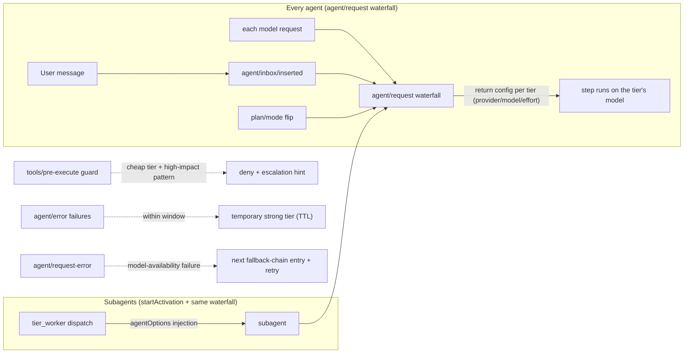
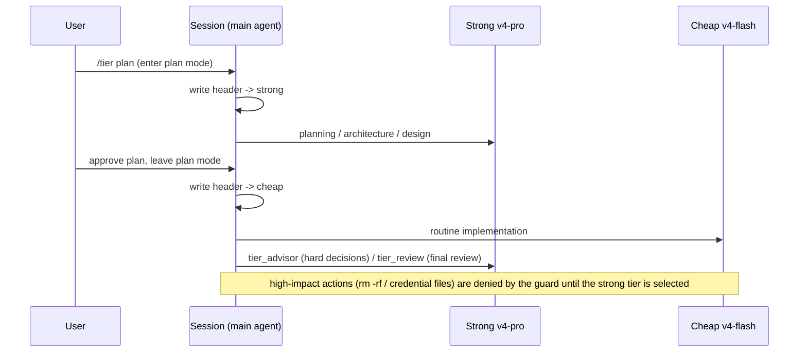

# dsh-tier-orchestrator — Tiered model routing for DeepSeek Harness

[](LICENSE)
[](https://github.com/topics/dsh-plugin)

handles planning / architecture / review**, while a **cheap tier (deepseek-v4-flash by
default) handles day-to-day implementation**, with per-tier fallback chains and
task-intensity reasoning effort. Inspired by Claude Code's `/advisor`
(consult a stronger model for hard decisions) and `opusplan` (strong model in plan mode,
cheap model for execution), implemented on DeepSeek Harness through its official seams,
with an escalation gate, failure auto-escalation, and subagent tiering on top.

English · [中文](README.zh.md)

## How it works



The waterfall seam returns the routed `LlmCallConfig` for **every** request, so
tier switches apply to the current step (no one-step delay) and the loop itself
writes the `request/header` log entries. On older runtimes without the
waterfall, a header-write fallback strategy (`applyHeaderRoute`) reproduces the
pre-0.2 behavior.



## Features

- **Automatic tiered routing (auto mode, opusplan-style)**: steps run on the strong tier
  while plan mode is active and on the cheap tier during execution. Before a loop
  builds its first or resumed request, the router synchronizes the agent's model
  options and durable `request/header`; later route changes preserve unrelated
  request settings such as `maxTokens`.
- **Per-session scoping**: `/tier strong|cheap|auto|delegated|off` affects **only the current
  session**; other sessions in the process keep their own tier (global default `auto`).
  In `delegated` mode the main session stays on its model-picker selection while only
  subagents use tier routing; `/tier auto` remains an explicit per-session override.
  Sessions that should not be managed can opt out with a single `/tier off`.
- **On-demand advice (advisor-style)**: the `/advisor <question>` command and the
  `tier_advisor` tool hand one decision question plus gathered evidence to the strong
  tier and return advice / evidence / risks / acceptance criteria; implementation stays
  on the current tier.
- **Review phase**: the `tier_review` tool and `/tier review <focus>` ask the strong tier
  to review a change set and return an `APPROVE / NEEDS-CHANGES / BLOCKED` verdict with
  issues ranked by severity.
- **Failure auto-escalation**: repeated step errors within a window (default 2 errors /
  60s) temporarily escalate the session to the strong tier (default 180s), expiring via
  TTL; sessions in `off` mode never escalate.
- **Configurable tiers (durable)**: `/tier set <strong|main|cheap> <provider> <model> [effort]` or the
  `tier_configure` tool can point each tier at any registered provider/model, configure
  the strong and main tiers to follow the session selection, and set ordered fallback chains.
- **Two independent switches**: `/tier layout <two|three>` (three adds a `main` tier: plan mode runs
  on main, execution on cheap, and strong becomes the escalation tier; two is the default), and
  `/tier roles <on|off>` (advisor and reviewer get their own models via `/tier set advisor|reviewer`;
  off, they use the strong route). A role has no fallback chain of its own and falls back to the
  strong chain. The review verdict warns in `/tier status` when the reviewer shares a model family
  with an implementer.
  Configuration persists on the host-level `tier-routing` profile entry and survives
  restarts (pass `sessionOnly: true` for a transient change).
- **WebUI settings**: every volatile field of the host `tier-routing` entry (mode,
  providers, models, reasoning effort, follow-session, fallback chains, subagent policy)
  appears on the plugin's auto-generated settings page in the DSH WebUI and persists
  through the profile patch — no hand-edited files. The former hand-built
  `client/client.js` settings card was removed in favor of this mechanism.
- **Seam self-diagnostics**: at startup the plugin probes every DSH service and event
  it uses; `/tier status` reports the active routing strategy (`waterfall`/`header`) and
  any missing capability. A missing seam degrades only the feature that needs it —
  the plugin itself keeps loading.
- **Per-tier fallback chains**: if the primary
  model is unavailable (unknown model, quota, rate limit, missing/invalid credential,
  server/transport error, or any status >= 500 failure), the router changes route at the
  supported request-error boundary and retries the same step on the next entry. Remove
  every entry to disable fallback. Fallback state is per agent and tier, returns to the
  primary after the fallback TTL (default 5 min, `state.fallbackTtlMs`), and never
  crosses from a cheap chain to a strong chain during a plan transition.
- **Task-intensity reasoning effort**: the strong tier follows your session model
  selection by default (`/tier set strong follow-session`); the cheap tier starts at
  `low` and raises itself through `medium`/`high`/`max` (bounded by the model's declared
  efforts) on cheap-tier retry errors, high-impact guard denials, or the
  `tier_escalate_effort` tool; `/tier effort <low|medium|high|max>` sets it manually.
  `tier_configure` and `/tier set` validate every effort against `llm.resolveModelInfo`,
  and the routing seam fits each request to the route's declaration before dispatch: an
  undeclared level is substituted, and a model that declares no reasoning support (many
  OpenRouter routes) receives no `reasoningEffort` at all, so a request never fails with
  `UNSUPPORTED_REASONING_EFFORT`.

  (pass `sessionOnly: true` for a transient change).
- **High-impact escalation gate (deterministic guard)**: while the cheap tier executes,
  `tools/pre-execute` denies high-impact tool calls and requires switching to the strong
  tier first — no reliance on model self-discipline. Guard rules (pure logic in
  `lib/core/guard.js`, unit-tested):
  - every `rm -rf` spelling: combined flags (`-rf`), split flags (`-r -f`), case variants
    (`-R`), long flags (`--recursive --force`), runner prefixes (`sudo rm -rf`, `busybox rm`);
  - destructive commands: `mkfs`, `dd if=`, `sudo`, `shutdown/reboot/halt`,
    `git push --force/-f`, `git clean -f*`, `find ... -delete` / `find ... -exec rm`,
    `python -c` with `shutil.rmtree` / `os.remove`, `curl|sh`, `wget|sh`,
    `chmod` on `.ssh`, `chown`;
  - sensitive paths: `.env` (whitelist for `.env.example/.template`), `credentials`/`secrets`
    with common extensions, `.ssh/`, private keys such as `id_rsa` (case-insensitive),
    `.pem`, `.key`;
  - prose never false-positives: `echo rm -rf`, `grep sudo` do not trigger
    (command-position anchored).
- **Subagent tiering**: `tier_worker` dispatches bounded task packets to a fresh subagent
  on a chosen tier (`agentOptions` model injection via `subagents.startActivation`),
  with `outputSchema` (structured results), `agentPreset` (compose the worker on a
  different preset — replaces the retired `persona`/`toolFilter` options, which DSH
  0.2 removed from the subagent contract), `maxDepth` (delegation-depth cap) and
  `background` (run via the jobs service, owned by the session id).
  `/tier subagent <inherit|cheap|strong>` also routes ordinary `subagent` and
  `subagent_fork` children before their first request; an automatic escalation remains
  temporary and never permanently overrides an explicitly selected worker tier.
- **Escalation rules injected into the system prompt**: ambiguity unresolved,
  architecture / security / data integrity, two failed attempts, high-risk completion —
  the model is guided to call `tier_advisor` / `tier_review` at decision points.
- **Smart mode (`/tier smart`)**: the Main Agent plans and reviews on the plan tier
  (`main` in the three-tier layout, `strong` otherwise) and never edits files directly —
  `write`/`edit`/`multi_edit`/`patch` are denied by the guard. Work is delegated to
  `tier_sidekick` in three stages: `explore` (compact file snippets), `implement`
  (code/tests/lint), `fix` (bug fixes). Each stage runs on its own model
  (`/tier set sidekick-<stage> <provider> <model> [effort]`), cheap tier by default.
- **Advisor per-turn budget**: `tier_advisor` allows `advisorMaxCallsPerTurn` calls
  (default 2) per user turn without asking; the next call asks through the approval seam
  (30s timeout) and fails closed without approval. The budget resets on each new user
  message. `forceTierOnExplicitModel` (default off) routes explicit-model subagent
  children by tier rules instead of keeping their seed.
- **TurboQuant 4-bit snippet cache**: local code embeddings (d=512, Signed Feature
  Hashing + FWHT) stored as 4-bit vectors (256 bytes each) in a persistent
  `.dsh-turbovec-cache.json` (via `ctx.fs`, in-memory fallback). `tier_sidekick`
  searches it for snippets and injects them into the prompt. `/tier cache
  status|clear|search <query>`.
- **Digest cards + stable prefixes (v0.8.1)**: each completed sidekick stage writes a
  memory card (diffSummary/checks/issues, capped 8 per stage) that later calls of the
  same stage inject as `Previous outcomes (memory):`. Prompt assembly uses a fixed
  per-stage preamble, so repeated calls share a byte-identical prefix for provider-side
  prompt-cache reuse. Snippet search scopes to `paths[]` (`k` raised to 8) and matches
  at a relaxed threshold.

## Installation

> **Plane note.** The bundle has two rows: a **host-plane** `tier-routing` entry
> that owns the durable tier configuration (edited from the Plugins page — the
> bundled `client/` browser module registers a "Tier routing" settings card on
> the plugin's entry, backed by the same host settings namespace),
> and an **agent-plane** `tier-routing-agent` row inside the bundled `tiered`
> agent preset. Tools, commands and routing listeners mount only for sessions
> on that preset; the preset is declared through `@deepseek-ai/dsh-agent-preset`,
> so no file copying into `~/.dsh/.agent-presets` is needed or possible (DSH 0.2
> no longer scans that directory).

```sh
# 1. Install into the profile.
dsh plugin --profile web add dsh-tier-orchestrator

# Local development uses the same installation path:
dsh plugin --profile web add .

# 2. Restart DSH, then choose "tiered" or "tiered-minimal" in the preset
#    picker for a new session (or make it the profile default). Configure on
#    the Plugins page: the dsh-tier-orchestrator card expands into the "Tier
#    routing" form once a session on either preset has run (the settings
#    namespace is host-served).
```

Two presets are provided:

- **`tiered`** — the standard roster: full DSH toolset plus tiered routing.
- **`tiered-minimal`** — a Pi-like minimal prompt (see
  [Minimal preset](#minimal-preset-tiered-minimal)).

Uninstall: `dsh plugin --profile web remove dsh-tier-orchestrator` removes both the
host entry and the `tiered` preset on the next startup.

### Post-install acceptance checklist

1. **Restart** DSH: kill the process LISTENing on the web port first
   (`lsof -tiTCP:<port> -sTCP:LISTEN | xargs kill -9`), then start it again.
2. **Open a NEW session** — existing sessions keep the preset they were created
   with (this is by design).
3. Run `/tier status` — it must report:
   - `config persisted: yes (host entry "tier-routing", writable)`,
   - `routing seam: waterfall` and `seams: all ok`,
   - both tiers with their provider/model/effort,
   - a `diag:` line with live counters.
4. The `tier_status`, `tier_route`, `tier_configure`, `tier_advisor`,
   `tier_review`, `tier_worker`, and `tier_sidekick` tools must be callable in
   that session.
5. While executing on the cheap tier, a high-impact command (e.g. `rm -rf`,
   `sudo …`) must be denied by the guard with an escalation hint.
6. `/tier set strong <provider> <model> [effort]` must reply
   `Saved to the tier-routing profile entry` and survive a restart; the same
   value appears on the plugin's generated settings page.

If `/tier status` is unavailable, the row is missing from the session's preset
(see Installation) or the session predates the preset switch.

### Minimal preset (`tiered-minimal`)

A Pi-style minimal prompt for users who want the leanest possible agent:

- **Persona**: one line (`You are an expert coding assistant.`), no
  time-context, no workspace-instruction budget (`agent-instructions`).
- **Tools**: exactly the Pi-shaped `read` / `write` / `edit` (registered by
  this plugin with sparse schemas; no fs-observation-policy, so edits do not
  require a prior read) plus the platform terminal — `bash` on POSIX,
  `pwsh` on Windows — with a one-line description. No skills, jobs, schedule,
  goal, todo, web, present, ask-user, subagents/workflow, fs-search, MCP, or
  plugin-manager tools.
- **System prompt**: the `tier-routing` section collapses to a few lines.
  Full routing guidance is available on demand via `tier_advisor`,
  `tier_review`, `tier_worker`, and `/tier`. A built-in hint tells the model
  to delegate tasks needing tools outside the minimal set (e.g. web, skills)
  via `tier_worker` with `agentPreset: tiered`, so heavy work can happen
  automatically without leaving the minimal session.
- **Plan mode**: still available; its instruction section enters the prompt
  only while plan mode is active.
- **Context compaction**: enabled.

Routing, escalation, fallback, and the advisor/review tools work identically
in both presets. Excluded capabilities are not lost: use them in a session on
the `tiered` preset, or spawn a worker on it from a minimal session with
`tier_worker` + `agentPreset: tiered`. The preset is chosen at session
creation; existing sessions keep theirs (DSH behavior).

## Usage

### Slash commands (typed in the composer; they affect only the current session)

```
/advisor <question>                          # one strong-tier consultation
/tier status                                # routing state, escalation state, diagnostics
/tier strong | cheap                        # force one tier for this session (optionally persist as session default)
/tier auto                                  # restore auto for this session (plan -> strong, execution -> cheap)
/tier delegated                             # keep the main session on the model picker; tier only subagents
/tier smart                                 # pin the main agent to the plan tier; file edits go through tier_sidekick
/tier cache <status|clear|search <query>>   # inspect/clear the TurboQuant snippet cache or query it
/tier off                                   # disable routing for this session, restore its default model (other sessions unaffected)
/tier plan                                  # auto + enter plan mode, apply the strong header immediately
/tier models                                # list registered providers and their models
/tier main                                  # route this session to the main tier (three-tier layout only)
/tier layout <two|three>                    # two tiers (default) or three (adds main; strong escalates)
/tier roles <on|off>                        # advisor and reviewer on their own models, or on the strong route
/tier gate explore <n>                      # read/search calls required before exit_plan_mode (0 disables)
/tier gate advisor <on|off>                 # advisor reviews each plan once before you see it
/tier gate advisor-limit <n> [timeoutSec]   # free tier_advisor calls per user turn; the next one asks for confirmation
/tier set <strong|main|cheap|advisor|reviewer> <provider> <model> [effort]
/tier set <strong|main> follow-session      # follow the session model selection
/tier set sidekick-<explore|implement|fix> <provider> <model> [effort] | reset
                                            # per-stage sidekick model for smart mode (blank = cheap tier)
/tier subagent [spawn|fork] <inherit|cheap|strong|main|caller|capped> # subagent route; caller is for fork only, capped never goes above main
/tier subagent force-explicit <on|off>      # route explicit-model subagent children by tier rules (default off)
/tier review <focus>                        # strong-tier review
```

Sample output (`/tier status`):

```
Tiered model routing
  mode: global=auto, this session=auto (per-session via /tier strong|cheap|auto|delegated|off; escalate: 2 errors / 60s window -> 180s strong)
  strong: deepseek-official/deepseek-v4-pro (max)
  cheap:  deepseek-official/deepseek-v4-flash (low)
  subagents: inherit
  diag: requestSteps=42 guardChecks=31 guardDenies=3 headerWrites=4 errorsSeen=0 escalations=0
  session default: deepseek-official/deepseek-v4-pro (max)
  providers: deepseek-official, opencode-go, minimax
```

### Model tools (called by the model when needed)

| Tool | Purpose |
| --- | --- |
| `tier_advisor` | Strong-tier consultation: one question + evidence -> advice / risks / acceptance criteria |
| `tier_review` | Strong-tier review: change set + validation results -> verdict with ranked issues |
| `tier_route` | Set **this session's** tier (strong/cheap/auto/delegated/smart/off, optionally persisted) |
| `tier_configure` | Reconfigure a tier (strong/main/cheap) or a role (advisor/reviewer) provider/model/effort, and the subagent policy |
| `tier_sidekick` | Smart-mode delegation: spawn a staged subagent (`explore`/`implement`/`fix`) on the stage model with TurboQuant cache injection |
| `tier_worker` | Dispatch a bounded task packet to a subagent on a chosen tier; supports outputSchema / agentPreset / maxDepth / background |
| `tier_status` | Read-only diagnostics: global & session tiers, escalation state, listener counters, effective tier |

## Configuration

Runtime configuration (no restart needed):

```sh
/tier set strong deepseek-official deepseek-v4-pro max
/tier set cheap deepseek-official deepseek-v4-flash low
```

`/tier set` and `tier_configure` persist the tier configuration on the host
`tier-routing` profile entry (survives restarts; pass `sessionOnly: true` for a
transient change). When the `settings` service is unreachable the plugin falls
back to in-memory configuration and `/tier status` says so honestly.
`tier_route strong|cheap|delegated` scopes to the current session and does NOT persist by default;
pass `persist: true` to also write the session default model (`agent-default-model`).
Failure auto-escalation parameters (threshold / window / TTL) are currently built-in
constants; configurable in a later version.

## Tests

```sh
npm test        # node:test — pure core logic + a mocked-context smoke suite covering
                # the agent/request waterfall, settings persistence, startActivation,
                # fallback chains, escalation and guard paths
npm run check   # syntax check for lib/index.js, lib/core/* and lib/dsh/*
```

Architecture notes for contributors: `lib/core/` is pure decision logic with no
DSH imports or I/O (unit-testable); `lib/dsh/` contains the only harness-facing
adapters (service probe, routing seam strategies, subagent/jobs adapters, the
settings bridge). A DSH breaking change should be fixable inside one `lib/dsh/`
file — that is the compatibility boundary by design.

Verified in live multi-round sessions (dynamic-plugin form):

| Area | Result |
| --- | --- |
| Main-session per-step routing (durable log evidence) | ✅ `request/header` events show the pro -> flash switch |
| Guard matrix (auto/strong/off) | ✅ auto denies / strong allows / off allows + restores default / auto-restored denies |
| Guard hardening (split flags, runner prefixes, prose, .env whitelist, case) | ✅ 7/7 live probes |
| Tools, positive paths | ✅ advisor/review hit the strong tier; route modes; configure; worker on both spawn and fork providers |
| Worker options | ✅ outputSchema structured result, agentPreset pass-through, maxDepth rejection, background jobs (toolFilter/persona verified on the pre-0.2 API; removed upstream since) |
| Tools, negative paths | ✅ invalid provider rejected, invalid subagent provider error |
| Subagent tiering | ✅ cheap tier on flash, strong tier on pro (child logs + return values) |
| Failure-escalation event path | ✅ `agent/error` fires, counters increment, off mode correctly skips |
| Lifecycle | ✅ stop removes guard & tools; re-run restores everything and the guard works |
| Persistence | ✅ `agent-default-model` written |
| Cross-turn listener survival | ✅ diagnostic counters keep incrementing across turns |

## FAQ

**Q: Why was another session's model switched automatically?**
Early versions were process-global. Since v0.3.0 `/tier` commands scope to the **current
session** only; other sessions default to `auto` independently. A session that should not
be managed runs `/tier off` to opt out.

**Q: The tier switch did not take effect immediately?**
On DSH 0.2 the `agent/request` waterfall applies routing to the very next model
call — there is no one-step delay. If `/tier status` reports `routing seam:
header` (older runtime), the switch applies from the next step instead.

**Q: How do I use subscription-channel models (OpenCode Go / MiniMax)?**
Run `/tier models` to confirm the provider is registered and its models are configured,
then `/tier set cheap opencode-go deepseek-v4-flash`. pi-ai-style providers must declare
`baseURL` / `api` / `models` in settings.yaml, otherwise every model id is rejected.

**Q: A high-impact action was blocked. What now?**
The guard's message tells you: switch to the strong tier first (`tier_route strong` or
`/tier strong`) and re-issue — the block exists precisely to keep the cheap tier from
running destructive actions directly.

**Q: `/tier` does not appear after installing the bundle?**
The session must be on the `tiered` preset (see Installation): routing is
agent-plane and only mounts inside that preset. The host `tier-routing` row
alone only carries the settings page. After switching presets, open a new
session and verify with `/tier status`.

## Known limitations

- On the header fallback seam (older runtimes), tier switches take effect from the
  next step; on the 0.2 waterfall seam they apply to the current request.
- `tier_worker`'s `agentPreset` option requires a subagent provider that declares
  preset support (`spawn` does); `toolFilter`/`persona` were removed upstream and
  cannot be emulated reliably.
- The subagent policy (`/tier subagent`) is process-wide and classifies child execution
  for the guard. A worker's tier is fixed at creation (`tier_worker` agentOptions); built-in
  `subagent`/`subagent_fork` children inherit the parent's model route.
- If the `settings` service is absent, configuration is in-memory only.
- The full live "fail -> self-heal" sequence for failure auto-escalation has been verified
  at the event path and unit-logic level; trigger it live per the FAQ if desired.

## Roadmap (not implemented yet)

- **N named tiers** beyond strong/cheap (`lib/core/tiers.js` is already an ordered
  registry; the config schema would gain an `extraTiers` field).
- **Ask-before-escalate policy**: `lib/core/policy.js` reserves an `ask` action and an
  `awaiting-confirm` escalation phase so a future version can prompt before handing a
  task to the stronger tier.
- **New consultation kinds**: `lib/core/consult.js` is a registry — advisor/review are
  entries; `delegate`/`diff-review` entries can be added without new plumbing.
- **Decision-model adapter (Jev / Clef / OpenRouter Decisions)**: a planned opt-in
  `lib/dsh/decisions.js` posting `{state, questions}` (noul/choice/score) to the
  OpenRouter Decisions API (`/api/alpha/decisions`) or any Jev-compatible endpoint
  (e.g. self-hosted `laya-server`); the model id is a config field, so Jev,
  Perplexity Decider, Clef, Drex etc. are interchangeable without code changes.
  Target use: the `ask` policy action, second-stage guard classification, and
  tier selection for `tier_worker`/`consult` — not the per-request hot path.
  No key or endpoint → silent fallback to the deterministic policy.

## License

MIT