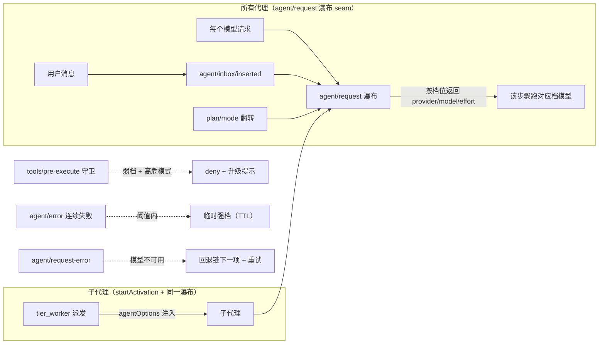
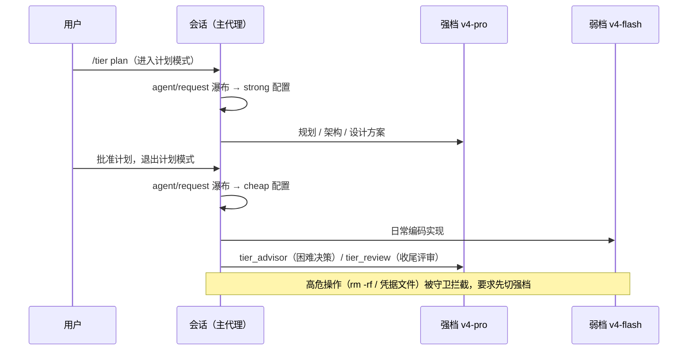

# dsh-tier-orchestrator — 分层模型路由 for DeepSeek Harness

[](LICENSE)
[](https://github.com/topics/dsh-plugin)

按任务难度分层路由模型：**强档（默认 deepseek-v4-pro）负责规划 / 架构 / 评审**，
**弱档（默认 deepseek-v4-flash）负责日常编码实现**，并支持每档回退链与按任务强度
自动选择思考强度。灵感来自 Claude Code 的 `/advisor`（困难决策咨询更强模型）与
`opusplan`（计划模式用强模型、执行用弱模型），
在 DeepSeek Harness 里用官方机制实现，并扩展了难度升级门、失败自动升级与 subagent 分层。

[English](README.md) · 中文

## 工作原理



DSH 0.2 的 `agent/request` 瀑布对**每个**请求生效，切档不再有一步延迟，
`request/header` 日志由 loop 自己写入。旧版本运行时（无瀑布 seam）会自动
降级为写 header 的兼容策略。



## 功能

- **自动分层路由（auto 模式，opusplan 式）**：进入计划模式时步骤跑强档，执行步骤跑弱档。
  DSH 0.2 的 `agent/request` 瀑布对每个模型调用返回路由配置，切换当步生效；旧运行时
  自动降级为写 header 的兼容策略（下一步生效）。切换会保留 `maxTokens` 等无关请求配置。
- **按会话隔离（per-session）**：`/tier strong|cheap|auto|delegated|off` 只影响当前会话，
  **进程内其他会话保持自己的档位**（全局默认 `auto`）。`delegated` 模式下主会话保持其
  基线模型（首个请求捕获的会话配置），只有子代理使用分层路由；`/tier auto` 仍是显式的
  本会话覆盖。不想被管理的会话发一次 `/tier off` 即可退出。
- **按需咨询（advisor 式）**：`/advisor <问题>` 命令 + `tier_advisor` 工具，把一个问题
  加已有证据交给强档模型，返回建议 / 证据 / 风险 / 验收条件；实现仍由当前档执行。
- **评审阶段**：`tier_review` 工具 + `/tier review <焦点>`，强档模型对变更与验证结果
  给出 `APPROVE / NEEDS-CHANGES / BLOCKED` 及分级问题清单。
- **失败自动升级**：同一会话在窗口内连续出错（默认 60s 内 2 次）自动临时切到强档
  （默认 180s），TTL 过期自动回落；`off` 会话不参与。
- **每档回退链**：每个 tier 都有有序回退链。主模型不可用（未知模型、配额、限流、
  凭据缺失/失效、server/transport 错误或任意 >= 500）时，路由器在受支持的
  request-error 边界切换到下一项并重试同一步。移除全部条目即可关闭回退。回退状态按
  agent 与 tier 分开记录，TTL（默认 5 分钟，`state.fallbackTtlMs`）后回到主模型，
  且计划模式切换不会把弱档回退链误解释为强档回退链。
- **两个独立开关**：`/tier layout <two|three>`（三档加入主档：计划模式走主档、执行走低成本档，
  强档成为升级档；默认双档）和 `/tier roles <on|off>`（顾问与审查通过 `/tier set advisor|reviewer`
  使用各自模型；关闭时走强档路由）。角色没有自己的降级链，回退到强档降级链。审查时若与执行者同
  家族，`/tier status` 会给出警告。
- **可配置双档（持久化）**：`/tier set <strong|main|cheap> <provider> <model> [effort]` 或
  `tier_configure` 工具可修改任意已注册 provider / model 并配置有序回退链。各档模型
  完全由插件配置决定——DSH 会话选择器不参与路由。配置持久化在 host 级 `tier-routing`
  profile 条目上，重启不丢；传 `sessionOnly: true` 可只改内存。
- **WebUI 设置页**：host `tier-routing` 条目的全部 volatile 字段（模式、provider、模型、
  思考强度、回退链、子代理策略）由 DSH 自动生成设置页并持久化，
  不再需要手写 `client/client.js`（已移除）。
- **seam 自诊断**：启动时探测所有用到的 DSH 服务与事件；`/tier status` 报告当前
  路由策略（`waterfall`/`header`）与缺失能力。某个 seam 缺失只会让对应功能降级，
  不会拖垮整个插件。
- **高危升级门（确定性守卫）**：当执行档为弱档时，`tools/pre-execute` 拦截高危工具调用，
  要求先切到强档再执行，不依赖模型自觉。守卫规则（纯逻辑 `lib/core/guard.js`，单元测试覆盖）：
  - `rm -rf` 全拼写：合并参数（`-rf`）、拆分参数（`-r -f`）、大小写（`-R`）、长参数
    （`--recursive --force`）、前缀命令（`sudo rm -rf`、`busybox rm`）；
  - 破坏性命令：`mkfs`、`dd if=`、`sudo`、`shutdown/reboot/halt`、`git push --force/-f`、
    `git clean -f*`、`find ... -delete` / `find ... -exec rm`、`python -c` 里的
    `shutil.rmtree` / `os.remove`、`curl|sh`、`wget|sh`、`chmod` 到 `.ssh`、`chown`；
  - 敏感路径：`.env`（`.env.example/.template` 白名单例外）、`credentials`/`secrets`
    常见扩展名、`.ssh/`、`id_rsa` 等私钥（大小写不敏感）、`.pem`、`.key`；
  - 散文不误伤：`echo rm -rf`、`grep sudo` 之类不触发（锚定命令位置）。
- **subagent 分层**：`tier_worker` 按档派发子代理（`subagents.startActivation` +
  `agentOptions` 注入模型），支持 `outputSchema`（结构化结果）、`agentPreset`
  （按其他预设组合 worker——替代上游已删除的 `persona`/`toolFilter`）、
  `maxDepth`（深度上限）、`background`（jobs 后台执行，owner 为 SessionId）；`/tier subagent
  <inherit|cheap|strong>` 也会在普通 `subagent` 与 `subagent_fork` 的首个请求前应用
  对应路由。自动升级始终受 TTL 限制，不会永久覆盖 worker 显式选择的档位。
- **难度升级规则注入**：向系统提示词注入升级门（歧义未消、架构 / 安全 / 数据完整性、
  两次失败、收尾高风险等条件），模型在决策点调用 `tier_advisor` / `tier_review`。
- **智能模式（`/tier smart`）**：主代理固定在规划档（三档布局为 `main`，否则 `strong`），
   不直接改文件——`write`/`edit`/`multi_edit`/`patch` 会被守卫拒绝。工作委托给
   `tier_sidekick` 三阶段：`explore`（紧凑文件片段）、`implement`（代码/测试/lint）、
   `fix`（修 bug）。每阶段可用独立模型（`/tier set sidekick-<stage> <provider> <model>
   [effort]`），默认为低成本档。
- **顾问每轮预算**：`tier_advisor` 在每轮用户对话里免费允许 `advisorMaxCallsPerTurn`
   次（默认 2）；下一次通过 approval 通道请求确认（30 秒超时），未获确认则失败关闭。
   新用户消息会重置预算。`forceTierOnExplicitModel`（默认关）让显式模型的子代理
   也按档位规则路由，而不是保留种子路由。
- **TurboQuant 4-bit 片段缓存**：本地代码向量化（d=512，Signed Feature Hashing + FWHT），
   以 4-bit 向量（每条 256 字节）持久化到 `.dsh-turbovec-cache.json`
   （走 `ctx.fs`，不可写时退回内存）。`tier_sidekick` 检索片段并注入提示词。
   `/tier cache status|clear|search <query>`。
- **决策模型阶段（Jev / System One / OpenRouter Decisions）**：可选的
  `lib/dsh/decisions.js` 客户端向 OpenRouter Decisions API（`/api/alpha/decisions`，
  base URL 与路径可配，任意 Jev 兼容端点均可）POST `{state, questions}`
  （noul/choice/score）。模型 id 是配置项而非代码：Jev、Perplexity Decider、Clef、
  Drex 等不改代码即可互换。按阶段开关 `decisionStages`（`guard`、`escalate`、
  `worker`、`consult`）：
  - `guard` — 高危拦截的二级分类：只有全部 noul 问题（`reversible`、
    `within_project`、`serves_task`）都明确 approve 才能推翻确定性 deny，其余一律
    维持拦截（fail-closed）。
  - `escalate` — 步骤失败的三级分流（`model_fault`）：高置信「非模型能力问题」会
    阻止自动升级到强档。
  - `worker` — `tier_worker` / `tier_sidekick` 未指定档位时挑选执行档（带置信度门限）。
  - `consult` — 门控 `tier_advisor` / `tier_review` / plan-exit 顾问评审：高置信
    「无需咨询」直接跳过高价强档调用。
  每轮预算、响应缓存（相同状态 60s 复用）与阈值（`approveAt`/`blockAt`）均可配置；
  无 key / 出错时回落到确定性策略。永不进入每请求热路径。
- **Digest 卡片 + 稳定前缀（v0.8.1）**：每个完成的 sidekick 阶段写入记忆卡片
   （diffSummary/checks/issues，每阶段上限 8），同阶段后续调用会作为
   `Previous outcomes (memory):` 注入。提示词使用固定的阶段前缀组装，使重复调用
   共享逐字节相同的前缀，利于 provider 端提示词缓存复用。片段检索会按 `paths[]`
   限定范围（`k` 提升至 8）并使用更宽松的匹配阈值。

## 安装

> **作用域说明**：bundle 包含两行——**host 层** `tier-routing` 条目持有持久化配置
> （在插件管理页编辑——随包的 `client/` 浏览器模块会在该插件卡片下注册
> “Tier routing” 设置表单，读写同一个 host 设置命名空间），**agent 层**
> `tier-routing-agent` 行位于随包声明的
> `tiered` agent preset 内。工具、命令与路由监听器只在使用该 preset 的会话中挂载。
> preset 通过 `@deepseek-ai/dsh-agent-preset` 声明，无需也不支持向
> `~/.dsh/.agent-presets` 拷贝文件（DSH 0.2 不再扫描该目录）。

```sh
# 1. 安装到 profile。
dsh plugin --profile web add dsh-tier-orchestrator

# 本地开发同样使用该安装路径：
dsh plugin --profile web add .

# 2. 重启 DSH，在新会话的预设选择器中选择 “tiered” 或 “tiered-minimal”
#    （或设为默认）。配置入口：插件管理页 → dsh-tier-orchestrator 卡片 → 展开出
#    “Tier routing” 设置表单（命名空间由 host 提供，需先用任一预设跑过一个会话）。
```

提供两个预设：

- **`tiered`** — 标准组合：完整 DSH 工具集 + 分档路由。
- **`tiered-minimal`** — Pi 式极简提示（见 [极简预设](#极简预设tiered-minimal)）。

卸载：`dsh plugin --profile web remove dsh-tier-orchestrator`，下次启动后 host 条目与
`tiered` preset 一并消失。

### 安装后验收清单

1. **重启 DSH**：先杀掉 LISTEN 在 web 端口的进程（`lsof -tiTCP:<端口> -sTCP:LISTEN | xargs kill -9`），再启动。
2. **新开一个会话**——已存在的会话保留创建时的 preset（设计如此）。
3. 运行 `/tier status`，必须看到：
   - `config persisted: yes (host entry "tier-routing", writable)`
   - `routing seam: waterfall` 与 `seams: all ok`
   - 两个 tier 各自的 provider/model/effort
   - `diag:` 行实时计数器
4. 该会话里必须能调用 `tier_status` / `tier_route` / `tier_configure` /
   `tier_advisor` / `tier_review` / `tier_worker` / `tier_sidekick` 七个工具。
5. 廉价档执行期间，高危命令（如 `rm -rf`、`sudo …`）必须被守卫拒绝并给出升级提示。
6. `/tier set strong <provider> <model> [effort]` 必须回复 `Saved to
   tier-router settings.` 且重启后仍然生效。

如果 `/tier status` 不可用：说明该会话的 preset 里缺 `tier-routing` 行（见"安装"），
或该会话创建于切换默认 preset 之前。

### 极简预设（`tiered-minimal`）

Pi 式极简提示，适合想要最精简 agent 的用户：

- **Persona**：一行（`You are an expert coding assistant.`），无 time-context，
  无 workspace 指令预算（`agent-instructions`）。
- **工具**：只有 Pi 风格的 `read` / `write` / `edit`（由本插件注册，schema 精简，
  无 fs-observation-policy——编辑不要求先读）加平台终端——POSIX 用 `bash`，
  Windows 用 `pwsh`——描述仅一行。不含 skills、jobs、schedule、goal、todo、
  web、present、ask-user、subagents/workflow、fs-search、MCP、plugin-manager 工具。
- **系统提示**：`tier-routing` 段折叠为几行；完整路由指引按需通过
  `tier_advisor` / `tier_review` / `tier_worker` / `/tier` 获取。内置提示会告诉模型：
  需要最小集之外工具（如 web、skills）的任务，应通过 `tier_worker` +
  `agentPreset: tiered` 自动委托，无需离开极简会话。
- **Plan 模式**：仍可用；其指令段只在 plan 模式激活时进入提示。
- **上下文压缩**：启用。

路由、升级、fallback、advisor/review 工具在两个预设中行为一致。被排除的能力
并未丢失：在 `tiered` 预设的会话中使用，或在极简会话里用 `tier_worker` +
`agentPreset: tiered` 派生带完整工具的子代理。预设在新会话创建时选择；已有会话
保留原预设（DSH 行为）。

## 使用

### 斜杠命令（在输入框直接输入，只作用于当前会话）

```
/advisor <决策问题>                          # 强档模型一次咨询
/tier status                                # 查看路由状态、升级状态与诊断计数器
/tier strong | cheap                        # 本会话强制走某档（可选持久化为会话默认）
/tier auto                                  # 本会话恢复自动（计划模式→强档，执行→弱档）
/tier delegated                             # 主会话保持模型选择器，仅对子代理分层
/tier smart                                 # 主代理固定在规划档；文件修改交给 tier_sidekick
/tier cache <status|clear|search <query>>   # 查看/清空 TurboQuant 片段缓存或按查询检索
/tier off                                   # 本会话关闭路由并恢复默认模型（不影响其他会话）
/tier plan                                  # auto + 进入计划模式，并立即应用强档 header
/tier models                                # 列出已注册 provider 与其模型
/tier main                                  # 本会话走主档（仅三档布局）
/tier layout <two|three>                    # 双档（默认）或三档（加入主档，强档作为升级档）
/tier roles <on|off>                        # 顾问与审查使用各自模型，或走强档路由
/tier gate explore <n>                      # exit_plan_mode 前所需的读/检索调用次数（0 关闭）
/tier gate advisor <on|off>                 # 计划提交前由顾问先评审一次
/tier gate advisor-limit <n> [timeoutSec]   # 每轮用户对话的免费 tier_advisor 次数；超限需确认
/tier set <strong|main|cheap|advisor|reviewer> <provider> <model> [effort]
# 各档模型完全由插件配置决定；DSH 会话选择器不参与路由
/tier set sidekick-<explore|implement|fix> <provider> <model> [effort] | reset
                                            # smart 模式各阶段的 sidekick 模型（留空 = 低成本档）
/tier subagent [spawn|fork] <inherit|cheap|strong|main|caller|capped> # 子代理路由；caller 仅用于 fork，capped 不超过主档
/tier subagent force-explicit <on|off>      # 显式模型的子代理也按档位规则路由（默认关）
/tier review <评审焦点>                       # 强档模型评审
```

示例输出（`/tier status`）：

```
Tiered model routing
  prompt mode: standard (standard = full guidance in the system prompt; pi = minimal prompt, heavy guidance on demand)
  mode: global=auto, this session=auto (per-session via /tier strong|main|cheap|auto|delegated|off|smart; escalate: 2 errors / 60s window -> 180s strong)
  layout: two tiers (strong = plan mode, cheap = execution); /tier layout three enables main
  strong: deepseek-official/deepseek-v4-pro (max); fallback: deepseek-official/deepseek-v4-pro@max
  cheap:  deepseek-official/deepseek-v4-flash (low); fallback: none
  roles: off (advisor and reviewer use the strong route; /tier roles on enables their own routes)
  decision model: off (deterministic policy is the fallback; set decisionModel + decisionStages to enable)
  config persisted: yes (host entry "tier-routing", writable)
  subagents: inherit (spawn: default, fork: default)
  routing seam: waterfall
  seams: all ok
  diag: requestSteps=42 guardChecks=31 guardDenies=3 headerWrites=4 inboxSeen=7 planFlips=1 errorsSeen=0 escalations=0 fallbacks=0 effortRaises=0 decisionCalls=0 decisionHits=0 decisionErrors=0 decisionSkips=0
  models come only from plugin config (host entry tiers; the DSH session picker is ignored)
  providers: deepseek-official, opencode-go, minimax
```

### 模型工具（由模型在需要时调用）

| 工具 | 用途 |
| --- | --- |
| `tier_advisor` | 强档咨询：一个问题 + 证据 → 建议 / 风险 / 验收条件 |
| `tier_review` | 强档评审：变更集 + 验证结果 → 判定与分级问题 |
| `tier_route` | 设置**本会话**档位（strong/cheap/auto/delegated/smart/off，可选持久化） |
| `tier_configure` | 重配任意档位的 provider/model/effort 与 subagent 策略 |
| `tier_sidekick` | smart 模式委托：按阶段（`explore`/`implement`/`fix`）派生子代理，注入 TurboQuant 缓存片段 |
| `tier_worker` | 按档派发子代理执行有界任务包；支持 outputSchema / agentPreset / maxDepth / background |
| `tier_escalate_effort` | 弱档思考强度上调一档（low → medium → high → max），不超过模型声明的上限 |
| `tier_status` | 只读诊断：全局与本会话档位、升级状态、监听器计数器、生效档位 |

## 配置

运行时配置（无需重启）：

```sh
/tier set strong deepseek-official deepseek-v4-pro max
/tier set cheap deepseek-official deepseek-v4-flash low
```

`/tier set` 与 `tier_configure` 会把双档配置持久化到 host `tier-routing` profile 条目
（重启不丢；`sessionOnly: true` 可只改内存）。`settings` 服务不可达时降级为纯内存配置，
`/tier status` 会如实提示。`tier_route strong|cheap|delegated` 只影响当前会话
且默认不持久化，传 `persist: true` 才写入会话默认模型（`agent-default-model`）。
失败自动升级参数（阈值 / 窗口 / 时长）当前为内建常量，后续版本可配置化。

决策模型没有斜杠命令——完全通过 host `tier-routing` 条目的 volatile 字段
（插件的 WebUI 设置页）配置：`decisionModel`、`decisionBaseUrl`、`decisionPath`、
`decisionApiKey`、`decisionStages`（`guard|escalate|worker|consult`）、
`decisionApproveAt`、`decisionBlockAt`、`decisionTimeoutMs`、`decisionBudgetPerTurn`。
`decisionModel` 留空（默认）时所有阶段关闭，零网络流量；`/tier status` 会显示
决策模型行与实时计数器。

## 测试

```sh
npm test        # node:test — core 纯逻辑 + mock 上下文冒烟（agent/request 瀑布、
                # settings 持久化、startActivation、回退链、升级与守卫路径）
npm run check   # 语法检查 lib/index.js、lib/core/*、lib/dsh/*
```

架构说明：`lib/core/` 是无 DSH 依赖、无 I/O 的纯决策层（可单测）；`lib/dsh/` 是唯一的
harness 适配层（服务探测、路由 seam 策略、subagent/jobs 适配、settings 桥）。未来 DSH
的 breaking change 理论上只需改 `lib/dsh/` 内单个文件——这是刻意设计的兼容边界。

会话内严格多轮实测（动态插件形态）记录：

| 项目 | 结果 |
| --- | --- |
| 主会话每步路由（持久日志证据） | ✅ `request/header` 事件显示从 pro 切到 flash |
| 守卫矩阵（auto/strong/off） | ✅ auto 拒 / strong 放行 / off 放行并恢复默认档 / 恢复 auto 拒 |
| 守卫加固（拆分参数、前缀 rm、散文、.env 白名单、大小写） | ✅ 7/7 实测通过 |
| 工具正向 | ✅ advisor/review 真调强档；route 四种模式；configure 改档；worker 在 spawn 与 fork 两个 provider 上完成 |
| worker 新参数 | ✅ outputSchema 结构化结果、agentPreset 透传、maxDepth 拒绝超限、jobs 后台（toolFilter/persona 为 0.2 之前 API 下的实测，上游已删除） |
| 工具反向用例 | ✅ 非法 provider 拒绝、非法 subagent provider 报错 |
| subagent 分层 | ✅ 弱档跑 flash、强档跑 pro（子代理日志与返回值证实） |
| 失败升级事件路径 | ✅ `agent/error` 真实触发、计数器自增、off 模式正确跳过 |
| 生命周期 | ✅ stop 后守卫与工具消失；重新 run 全部恢复且守卫生效 |
| 持久化 | ✅ `agent-default-model` 写入成功 |
| 跨回合监听器存活 | ✅ 诊断计数器跨回合持续自增 |

## FAQ

**Q: 为什么我另一个会话的模型被自动切换了？**
早期版本是进程级全局模式。v0.3.0 起 `/tier` 命令只作用于**当前会话**，
其他会话默认 `auto` 且互不影响；不想被管理的会话输入 `/tier off` 即可退出。

**Q: 切换档位后没有立刻生效？**
DSH 0.2 的 `agent/request` 瀑布让切档作用于下一个模型调用——没有一步延迟。
若 `/tier status` 显示 `routing seam: header`（旧运行时），则从下一步生效。

**Q: 开了 smart 模式，但日志里只有我常用的（廉价）会话模型？**
这是旧的 follow-session 行为，已移除：强档与主档现在总是跑插件配置里的
provider/model（host `tier-routing` 条目），DSH 会话选择器不参与路由。若规划档
仍在调用廉价模型，请改档位配置（`/tier set strong <provider> <model> [effort]`）；
`/tier status` 会打印生效路由（`smart: main agent pinned to strong; effective
route now: ...`）。

**Q: 想用订阅渠道的模型（如 OpenCode Go / MiniMax）？**
先 `/tier models` 确认 provider 已注册、模型已配置，再
`/tier set cheap opencode-go deepseek-v4-flash`。pi-ai 类 provider 必须在
settings.yaml 中声明 `baseURL`/`api`/`models`，否则任何模型 id 都会被拒绝。

**Q: 高危操作被拦了怎么办？**
守卫的提示会告诉你：先 `tier_route` 切到 `strong`（或 `/tier strong`）再重试——
拦截本身就是为了避免弱档模型直接执行破坏性操作。

**Q: 装完 bundle 后 `/tier` 不出现？**
会话必须使用 `tiered` preset（见"安装"）：路由属于 agent 层，只在该 preset 内挂载；
host 层 `tier-routing` 行只承载设置页。切换 preset 后新开会话，用 `/tier status` 验证。

## 已知限制

- 旧运行时的 header 降级 seam 下切档从下一步生效；0.2 瀑布 seam 下当请求生效。
- `tier_worker` 的 `agentPreset` 需要子代理 provider 声明 preset 能力（`spawn` 支持）；
  `toolFilter`/`persona` 已被上游删除，无法可靠模拟。
- 子代理全局档位策略（`/tier subagent`）是进程级的；worker 的单次派发档位始终优先。
- `settings` 服务缺失时配置仅内存有效。
- 失败自动升级的完整"失败→自愈"现场序列在会话内已验证事件路径与单元逻辑，端到端
  现场触发建议按 FAQ 操作验证。

## 路线图（尚未实现）

- **N 个命名档**：`lib/core/tiers.js` 已是有序注册表，未来配置加 `extraTiers` 即可。
- **升级前先询问**：`lib/core/policy.js` 预留 `ask` 动作与 `awaiting-confirm` 阶段，
  未来可在交给强档前弹确认。
- **新咨询类型**：`lib/core/consult.js` 是注册表——advisor/review 是条目，未来加
  delegate/diff-review 无需新管线。

## 许可

MIT